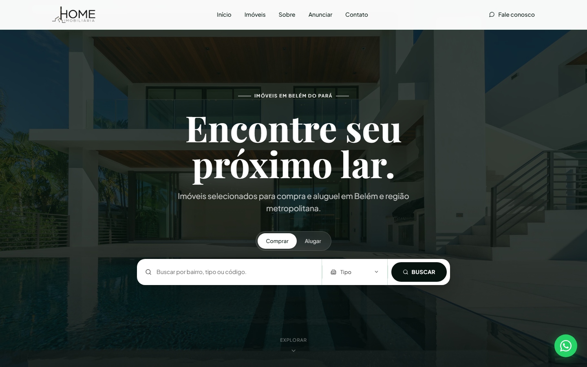
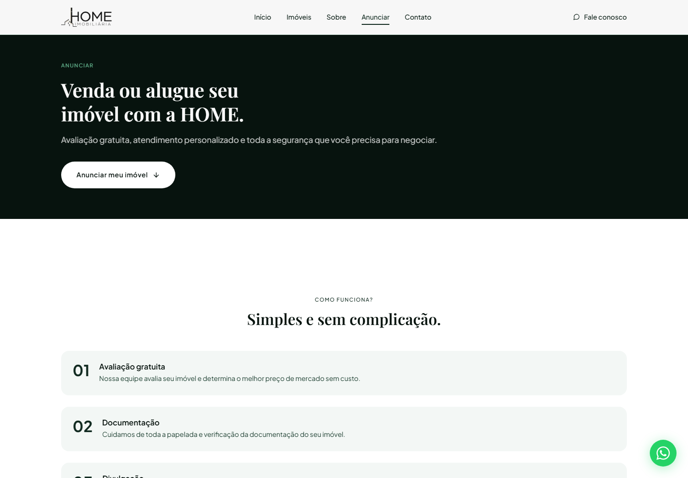
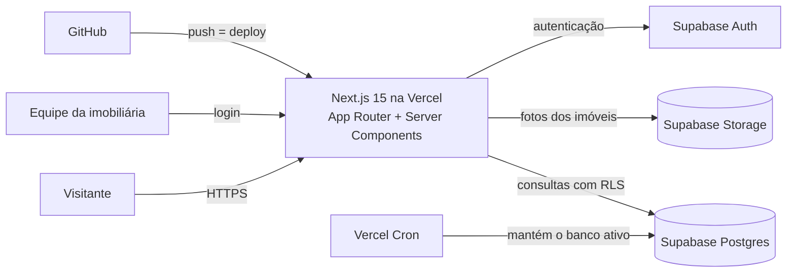

# Home Imobiliária: site e painel administrativo construídos com IA

> **Case de portfólio.** Este é um projeto real de cliente, em produção em **[homeimobiliaria.imb.br](https://www.homeimobiliaria.imb.br)**. A imobiliária é recém-aberta e ainda vai cadastrar os primeiros imóveis, por isso o catálogo pode aparecer vazio. O código-fonte é privado. Aqui eu documento o problema, as decisões de arquitetura, o processo de construção com IA e os resultados.

## Resumo

| | |
|---|---|
| **Cliente** | Home Imobiliária, Belém (PA) |
| **Meu papel** | Freelance solo, de ponta a ponta: produto, design, desenvolvimento, deploy e suporte |
| **Período** | mai/2026 – set/2026 (em produção desde ago/2026, domínio próprio desde set/2026) |
| **Stack** | Next.js 15 (App Router), React 19, TypeScript, Tailwind CSS v4, Supabase, Vercel |
| **Escala** | 6 páginas públicas, 10 páginas administrativas, 34 componentes, cerca de 50 commits |
| **Como construí** | Com o Claude Code como par de desenvolvimento contínuo; as decisões ficaram comigo |

## O problema

A imobiliária precisava de um site próprio com dois objetivos:

1. **Vitrine e captação:** o visitante busca imóveis para comprar ou alugar e fala com um corretor em um clique.
2. **Operação:** a equipe cadastra e mantém imóveis e acompanha os leads sem depender de um desenvolvedor.

## O que foi entregue

**Site público**
- Home com busca por bairro, tipo ou código, e alternância entre comprar e alugar
- Catálogo com filtros (finalidade, tipo, preço, quartos, vagas)
- Página de detalhe do imóvel com galeria e mapa
- Formulário de contato e fluxo "Anunciar meu imóvel" com upload de fotos
- Atalho para WhatsApp em todas as páginas, responsivo para celular

**Painel administrativo** (área com login)
- Cadastro, edição e remoção de imóveis
- Gestão de leads vindos dos formulários
- Lixeira com recuperação (*soft delete*)
- Exportação de dados para CSV e XLSX

  
  &nbsp;
  

## Arquitetura

- **Segurança no banco:** políticas de Row Level Security (RLS) no Supabase separam o que é público do que é exclusivo da área administrativa.
- **CI/CD:** cada push no GitHub gera um deploy na Vercel, e as mudanças são testadas em ambiente isolado antes de ir para produção.

## Como a IA foi usada

O projeto foi construído com o **Claude Code** como par de desenvolvimento contínuo, não como gerador pontual de código. A divisão de papéis foi clara:

| Eu decidi | A IA executou, sob revisão |
|---|---|
| Escopo, prioridades e o que entra no ar | Implementação de páginas e componentes |
| Direção visual com o cliente (paleta, tipografia) | Variações de design testadas em ambiente isolado |
| Aprovação de **todo** deploy em produção | Investigação de bugs, testes e validação |

Três momentos em que a IA fez diferença real:

1. **Debugging de causa raiz.** O cliente relatou que o site "travava ao navegar". A causa óbvia não era a real, então investiguei com a IA até encontrar a verdadeira e corrigi. **A navegação na Home caiu de até 13 s para ~6 ms**, medido com dado real de produção.
2. **Auditoria de segurança proativa.** Fiz uma revisão das rotas de API e das dependências antes que virassem problema. As correções foram aplicadas e validadas em produção no mesmo dia.
3. **Orquestração de várias sessões.** Em parte do projeto, duas sessões do Claude Code trabalharam coordenadas, uma no levantamento de requisitos com o cliente e outra no repositório, sempre com a minha aprovação antes de qualquer deploy.

## Resultados

- Site **em produção** desde ago/2026, em domínio próprio
- Painel pronto para a equipe cadastrar imóveis e tratar leads **sem depender de um desenvolvedor**
- Navegação de **até 13 s → ~6 ms** após a correção da causa raiz
- Do primeiro commit à produção em **cerca de 2 meses**, trabalhando sozinho

## O que este repositório não contém

Por ser trabalho de cliente, ficam de fora: código-fonte, credenciais, dados de clientes e leads, detalhes técnicos de vulnerabilidades e valores comerciais.

---

**Phellipe Fialho** · [LinkedIn](https://www.linkedin.com/in/phellipefialho) · phellipefialho.prof@gmail.com
